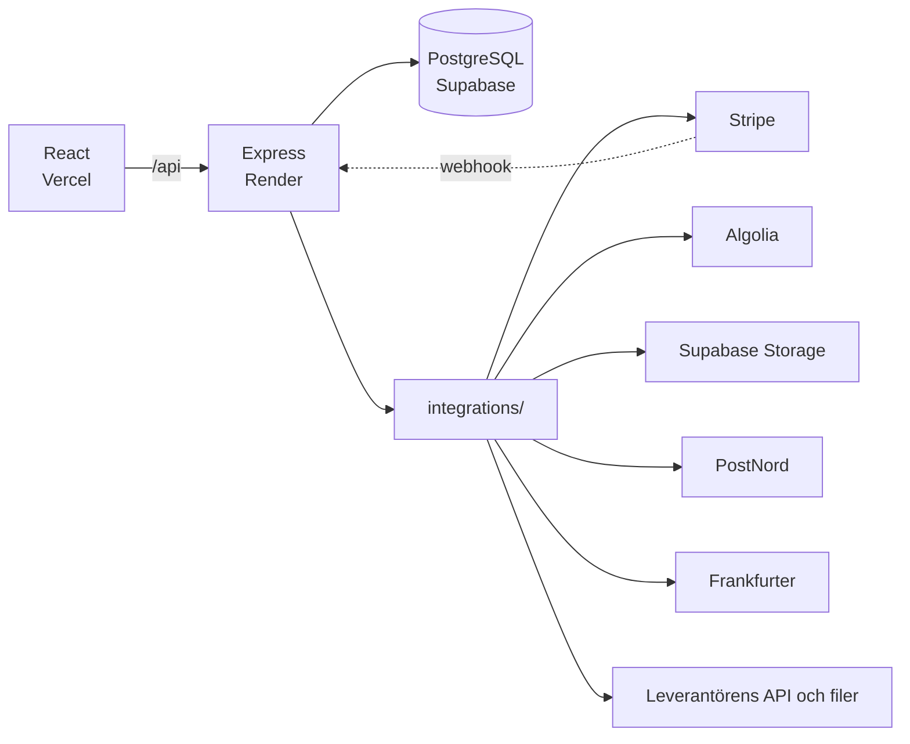

# ReLoved

<div align="center">
**Älskat tidigare. Älskat igen.**

En marknadsplats för second hand-kläder och accessoarer där vem som helst kan köpa och sälja – med riktig betalning, sökning, frakt och bildlagring kopplade till externa tjänster.

[**Öppna butiken →**](https://re-loved.vercel.app) · [API](https://reloved.onrender.com/api) · [Integrationer](docs/integrationer.md) · [Reflektion](docs/reflektion.md)

</div>

---

## Funktioner

**För köpare**
- Söka med stavfelstolerans, filter (kategori, skick, pris), sortering och sidor
- Favoriter, varukorg som följer med mellan inloggningar, och priser i SEK, EUR, USD eller GBP
- Kassa med PostNord: välj ombud nära ditt postnummer eller hemleverans, se beräknad leverans, fri frakt från 500 kr
- Säker kortbetalning via Stripe Checkout, och orderstatus som uppdateras när betalningen är bekräftad

**För säljare**
- Lägg upp annonser med bild, redigera dem och följ försäljningen
- Annonser granskas av admin innan de publiceras

**För admin**
- Skapa och redigera produkter med bilder i molnlagring
- Godkänn eller neka annonser, hantera ordrar och orderstatus
- Importera leverantörens produktkatalog (CSV, XML eller API) och bygga om sökindexet

## Tech stack

| Lager | Teknik |
|---|---|
| Frontend | React 19, TypeScript, Vite, React Router |
| Backend | Node.js, Express 5, Zod |
| Databas | PostgreSQL (Supabase) |
| Autentisering | JWT och bcrypt, roller (kund, säljare, admin) |
| Integrationer | Stripe, Algolia, Supabase Storage, PostNord, Frankfurter |
| Drift | Vercel (frontend) och Render (API) |

## Arkitektur



React pratar bara med vårt eget API. Varje extern tjänst har en egen **adapter** i `server/integrations/` – det enda stället som känner till tjänstens adress, nycklar och format. Adaptern validerar svaren med Zod, har timeout och returnerar ReLoveds egen modell, så att resten av koden inte påverkas om en tjänst byts ut eller ändras.

| Tjänst | Används till | Modell | Adapter |
|---|---|---|---|
| Stripe | Betalning | SDK, redirect och webhook | `paymentAdapter.ts` |
| Algolia | Sökning | SDK | `searchAdapter.ts` |
| Supabase Storage | Produktbilder | SDK | `storageAdapter.ts` |
| PostNord | Ombud och leveranstid | REST | `shippingAdapter.ts` |
| Frankfurter | Valutakurser | REST | `currencyAdapter.ts` |
| Leverantören | Produktkatalog | Fil (CSV/XML) och REST | `supplierAdapter.ts` |

Hur varje integration fungerar, vad som händer när tjänsten är nere och varför den är byggd så beskrivs i [**docs/integrationer.md**](docs/integrationer.md).

## Kom igång

Projektet består av två delar som körs samtidigt: API:et (`server/`) och frontend (`reloved-app/`). Kräver Node 22.6 eller senare, eftersom adaptrarna är skrivna i TypeScript och körs direkt av Node.

### Förutsättningar

- Node.js 22.6 eller senare (servern kör TypeScript-adaptrarna direkt med Node)
- Gratiskonton i testläge hos tjänsterna nedan. Inga riktiga pengar eller avtal behövs.

| Tjänst | Används till | Konto |
|---|---|---|
| [Supabase](https://supabase.com) | Databas och produktbilder | Gratis projekt |
| [Algolia](https://www.algolia.com) | Sökning | Gratis (Build) |
| [Stripe](https://stripe.com) | Betalning | Testläge (`sk_test_`) och [Stripe CLI](https://docs.stripe.com/stripe-cli) |
| [PostNord](https://atdeveloper.postnord.com) | Ombud och leveranstid | Sandlåda, Customer plan |
| Frankfurter | Valutakurser | Ingen nyckel |

Alla nycklar hamnar i `server/.env`, som aldrig committas. [`server/.env.example`](server/.env.example) visar alla variabler som behövs.

### 1. Databas

Skapa ett gratis Supabase-projekt och kör följande i SQL Editor:

1. [`database/schema.sql`](database/schema.sql) – tabeller, exempeldata och kolumnerna för leverantörsimporten (`sku`, `ean`, `stock`, `variants`).
2. [`database/migrations/002_payments.sql`](database/migrations/002_payments.sql) – orderstatus `pending`/`paid`, koppling till Stripe och funktionen `mark_order_paid`.
3. [`database/migrations/003_product_images.sql`](database/migrations/003_product_images.sql) – kolumnen `image_path` för produktbilder.
4. [`database/migrations/004_shipping.sql`](database/migrations/004_shipping.sql) – frakten på ordern (fraktalternativ, ombud, beräknad leverans).
5. Skapa en **publik** Storage-bucket som heter `products` för produktbilder.

### 2. Backend (API)

```bash
cd server
npm install
cp .env.example .env
```

Fyll i `server/.env`. Alla variabler finns i [`server/.env.example`](server/.env.example):

| Variabel | Behövs för | Var får jag värdet? |
|---|---|---|
| `SUPABASE_URL`, `SUPABASE_SERVICE_KEY` | Databas och produktbilder | Supabase → Project Settings → API |
| `JWT_SECRET` | Inloggning | Valfri lång slumpmässig sträng |
| `CURRENCY_API_URL`, `CURRENCY_API_TIMEOUT_MS`, `CURRENCY_CACHE_SECONDS` | Valutaomvandling | Färdiga värden i `.env.example`, ingen nyckel behövs |
| `SUPPLIER_API_KEY` | Produktimport | Kursens testnyckel för leverantörs-API:et |
| `SUPPLIER_API_URL`, `SUPPLIER_API_TIMEOUT_MS`, `SUPPLIER_BRANSCH` | Produktimport | Färdiga värden i `.env.example` |
| `ALGOLIA_APP_ID`, `ALGOLIA_ADMIN_KEY`, `ALGOLIA_SEARCH_KEY`, `ALGOLIA_INDEX` | Sökning | Algolia → Settings → API Keys (gratiskonto). Utan `ALGOLIA_APP_ID` startar inte servern. |
| `STRIPE_SECRET_KEY` | Betalning | Stripe (testläge) → Developers → API keys, börjar med `sk_test_` |
| `STRIPE_WEBHOOK_SECRET` | Betalning | Lokalt: `whsec_...` från `stripe listen`. Deployat: från webhook-endpointen i Stripe Dashboard |
| `CLIENT_URL`, `CHECKOUT_EXPIRES_MINUTES` | Betalning | Dit Stripe skickar kunden tillbaka, och hur länge en betalning får pågå (30 min) |
| `POSTNORD_API_KEY` | Frakt | PostNords sandlådeportal (atdeveloper.postnord.com) → Customer plan → application |
| `POSTNORD_API_URL`, `POSTNORD_TIMEOUT_MS`, `POSTNORD_CUSTOMER_KEY` | Frakt | Färdiga värden i `.env.example` (sandlådan `https://atapi2.postnord.com`) |
| `SHOP_POSTAL_CODE`, `SHOP_STREET`, `SHOP_CITY`, `SHOP_ORDER_CUTOFF`, `FREE_SHIPPING_FROM` | Frakt | Lagrets adress, sista ordertid och gränsen för fri frakt |

Starta:

```bash
npm run dev
```

API:et körs på `http://localhost:3001`.

**Testa betalningar lokalt:** installera [Stripe CLI](https://docs.stripe.com/stripe-cli), kör `stripe login` och låt den här stå igång i en egen terminal:

```bash
stripe listen --events checkout.session.completed,checkout.session.async_payment_succeeded,checkout.session.expired --forward-to localhost:3001/api/stripe/webhook
```

Betala med testkortet `4242 4242 4242 4242`, ett datum i framtiden och valfri CVC.

### 3. Frontend

```bash
cd reloved-app
npm install
```

Skapa en `.env` i `reloved-app/` (valfritt lokalt, standard pekar på localhost):

```
VITE_API_URL=http://localhost:3001/api
```

Starta:

```bash
npm run dev
```

Appen körs på `http://localhost:5173`.

## Deploy

- **Frontend:** Vercel, med `VITE_API_URL` satt till API:ets adress.
- **Backend:** Render, startkommando `node server.js`. Samma variabler som i `server/.env` ligger under Environment i Render, med `CLIENT_URL=https://re-loved.vercel.app`.
- **Stripe:** en webhook-endpoint i Stripe Dashboard pekar på `https://reloved.onrender.com/api/stripe/webhook` med händelserna `checkout.session.completed`, `checkout.session.async_payment_succeeded` och `checkout.session.expired`.

## Projektstruktur

```
ReLoved/
├── docs/                     # ER-diagram, sitemap, användarflöde, tidsplan, API-plan
├── database/
│   ├── schema.sql            # Tabeller och seed-data
│   └── migrations/           # Ändringar för labbarna (002–004)
├── server/                   # Express-API
│   ├── integrations/         # En adapter per extern tjänst (valuta, leverantör, sök, betalning, bildlagring, frakt)
│   ├── lib/                  # Supabase-klient, bilduppladdning, fetchJson, searchSync, fraktpriser, cartPricing
│   ├── middleware/           # requireAuth / requireAdmin
│   ├── routes/               # products, orders, cart, favorites, auth, users, categories, admin, seller,
│   │                         # currency, search, checkout, webhook, shipping
│   └── server.js
└── reloved-app/              # React + TypeScript-frontend
    ├── src/
    │   ├── api/              # API-klient (fetch)
    │   ├── components/       # Header, Footer, RequireAuth, RequireAdmin ...
    │   ├── context/          # Auth, Cart, Favorites, Toast, Currency
    │   ├── pages/            # Publika sidor + admin/ + seller/
    │   └── types/            # TypeScript-typer
    └── ...
```

## Dokumentation

- [Integrationer](docs/integrationer.md) – varje extern tjänst i detalj, inklusive hur AI användes för frakten
- [Reflektion](docs/reflektion.md) – integrationsmodeller, val och risker
- [`docs/`](docs/) – ER-diagram, sitemap, användarflöde och API-plan

## Licens

Utbildningsprojekt – inte för kommersiellt bruk.
Utbildningsprojekt — ej för kommersiellt bruk.