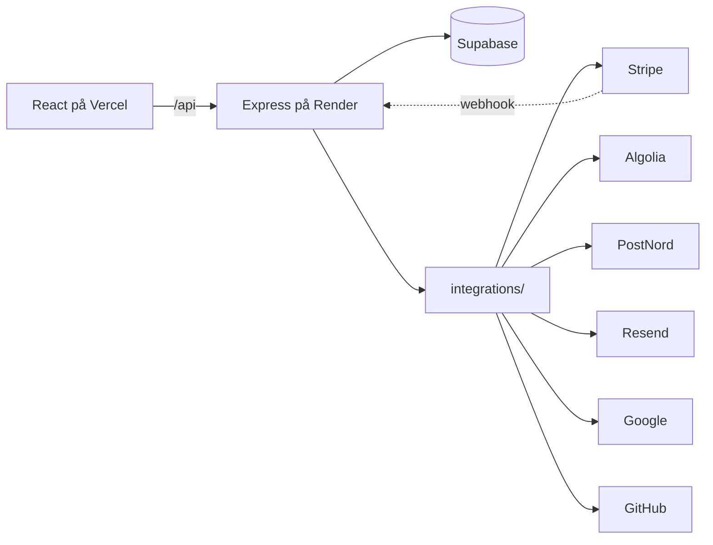

# ReLoved

ReLoved är en webbshop för second hand kläder där privatpersoner säljer till varandra. Varje annons granskas innan den publiceras, och köparen betalar med kort.

Butiken finns på [re-loved.se](https://re-loved.se). Betalningen körs i Stripes testläge, så inga riktiga pengar dras. Testa med kortnumret `4242 4242 4242 4242`, ett datum i framtiden och valfri CVC.

---

## Funktioner

**Köpare** söker bland plaggen med stavfeltolerans, filtrerar på kategori, skick och pris. Sparar favoriter och ser priser i SEK, EUR, USD eller GBP. I kassan väljer kunden ett PostNord-ombud nära sitt postnummer eller hemleverans, betalar via Stripe och får en orderbekräftelse via e-post. Inloggade kunder ser sina ordrar under Mina ordrar.

**Säljare** lägger upp annonser med bild, redigerar dem och följer sina försäljningar.

**Administratörer** godkänner eller nekar annonser, hanterar produkter, kategorier och orderstatus, importerar leverantörens katalog och rapporterar fel direkt till projektets ärenden på GitHub.

## Tech stack

| Del                | Teknik                                          |
| ------------------ | ----------------------------------------------- |
| Frontend           | React 19, TypeScript, Vite, React Router        |
| Backend            | Node.js 22, Express 5, Zod                      |
| Databas och bilder | PostgreSQL och Storage i Supabase               |
| Drift              | Vercel (frontend), Render (API), Loopia (domän) |

## Arkitektur



React pratar bara med det egna API:et. Vercel skickar alla anrop till `/api` vidare till Render, så att frontend och API nås på samma adress.

Varje extern tjänst har en egen adapter i `server/integrations/`. Adaptern är det enda stället som känner till tjänstens adress, nycklar och svarsformat. Den har en timeout, validerar svaren med Zod och returnerar shoppens egen modell. Byts en tjänst ut påverkas bara en fil.

| Tjänst            | Används till                                    | Adapter                |
| ----------------- | ----------------------------------------------- | ---------------------- |
| Stripe            | Betalning via Checkout och webhook              | `paymentAdapter.ts`    |
| Algolia           | Sökning, filter och sortering                   | `searchAdapter.ts`     |
| Supabase Storage  | Produktbilder                                   | `storageAdapter.ts`    |
| PostNord          | Ombud och leveranstid                           | `shippingAdapter.ts`   |
| Frankfurter       | Valutakurser                                    | `currencyAdapter.ts`   |
| Leverantörens API | Produktkatalog i CSV, XML och JSON              | `supplierAdapter.ts`   |
| Google            | Inloggning för kunder                           | `googleAuthAdapter.ts` |
| GitHub            | Inloggning för administratörer och felrapporter | `githubAdapter.ts`     |
| Resend            | Orderbekräftelser via e-post                    | `emailAdapter.ts`      |

Hur varje integration fungerar och vad som händer när den inte svarar beskrivs i [docs/06-integrationer.md](docs/06-integrationer.md).

## Inloggning

Kunder loggar in med e-post och lösenord eller med Google. Administratörer loggar in med GitHub. All inloggning går via servern, och nycklarna finns bara i serverns miljövariabler.

### Session med JWT i en httpOnly-cookie

Efter inloggningen sätter servern en egen JWT i cookien `reloved_session`, med `httpOnly`, `secure` och `SameSite=Lax`. Den gäller i sju dagar.

Jag valde en JWT i stället för en session i databasen:

- JavaScript kan inte läsa en httpOnly-cookie, så en XSS-attack kan inte komma åt inloggningen. Tidigare låg token i localStorage, där all kod på sidan kunde läsa den.
- Servern behöver ingen sessionstabell, bara kontrollera signaturen. Det passar en server som kan starta om när som helst.
- Nackdelen är att en JWT inte kan återkallas innan den går ut. Därför är giltighetstiden begränsad, och utloggning tar bort cookien.
- Eftersom Vercel skickar `/api` vidare till Render ser webbläsaren bara en adress. Cookien blir en förstapartscookie och blockeras inte.

Googles och GitHubs tokens används bara på servern under inloggningen och sparas aldrig.

### Google

Inloggningen följer OAuth 2.0 och OpenID Connect med authorization code flow. Varje försök skyddas med `state`, PKCE (S256) och `nonce`, som sparas i en signerad cookie i tio minuter. Koden byts mot tokens på servern med client secret och code verifier. ID-tokenet valideras med Zod: utfärdare, mottagare, giltighetstid, nonce och verifierad e-post. Appen ber bara om `openid email profile`.

Kunden känns igen på Googles `sub`, som aldrig ändras. Första gången skapas en kund med `sub`, e-post och namn. Finns e-postadressen redan hos ett konto med lösenord slås kontona inte ihop. Kunden får i stället ett meddelande om att logga in med sitt lösenord. En automatisk sammanslagning skulle ge den som kontrollerar ett Google-konto med samma adress tillgång till någon annans ordrar och adress.

### GitHub

Administratörer loggar in med GitHub med `state` och PKCE, och appen ber bara om `read:user`. Bara användarnamn i `ADMIN_GITHUB_LOGINS` blir administratörer. Övriga får ett felmeddelande. Administratören sparas med GitHubs `id`, eftersom användarnamnet kan ändras. En regel i databasen gör att bara konton med ett GitHub-id kan ha rollen admin.

## Betalning och orderbekräftelse

Kassan sparar en obetald order och skickar kunden till Stripe Checkout. Ordern blir betald först när Stripes signerade webhook kommer fram. Databasfunktionen `mark_order_paid` gör det exakt en gång och minskar lagret i samma transaktion. Kommer kunden tillbaka innan webhooken har kommit frågar servern Stripe direkt.

När ordern är betald skickar servern en orderbekräftelse med Resend från `order@re-loved.se`. Mejlet innehåller ordernummer, kundens namn, produkterna med antal och pris samt totalsumman, både som HTML och som text. Allt som kunder och säljare har skrivit escapas innan det hamnar i HTML:en.

- Varje utskick har nyckeln `order-confirmation/{orderns id}`. Om Stripe skickar webhooken igen får kunden ändå bara ett mejl.
- Mejlet skickas efter att Stripe har fått sitt svar. Svarar Resend inte, eller svarar med ett fel, loggas felet. Ordern är ändå betald.
- Mallarna ligger i `server/emails/`. Utseendet är samlat i `styles.js` och sätts in inline när mejlet byggs, eftersom e-postprogram inte läser CSS-filer.

Domänen är verifierad i Resend med DKIM, SPF och DMARC.

## Felrapporter

Administratörer kan rapportera fel från administratörspanelen. Servern skapar ett ärende i repot med en egen fine-grained token som bara har behörigheten Issues: Read and write för det här repot. GitHub visar tokenens ägare som författare, så servern skriver in vilken administratör som rapporterade felet. Panelen listar också öppna ärenden med länkar till GitHub.

## Sökindex

Produkterna söks i Algolia, som håller en kopia av databasen. Indexet uppdateras när en produkt sparas, säljs eller tas bort. Varje natt bygger ett GitHub Actions-jobb om hela indexet via `POST /api/cron/reindex`, som skyddas av `CRON_SECRET`. Omindexeringen tar några minuter, så servern svarar direkt och bygger klart i bakgrunden.

## Kom igång

Projektet består av API:et i `server/` och frontend i `reloved-app/`. Du behöver Node.js 22.6 eller senare, eftersom servern kör TypeScript-adaptrarna direkt.

### Databas

Skapa ett projekt i Supabase och kör filerna i SQL Editor i den här ordningen:

1. `database/schema.sql`
2. `database/migrations/payments.sql`
3. `database/migrations/shipping.sql`
4. `database/migrations/sizes.sql`
5. `database/migrations/google_login.sql`
6. `database/migrations/github_admin.sql`

Skapa sedan en publik Storage-bucket som heter `products`.

### Server

```bash
cd server
npm install
cp .env.example .env
npm run dev
```

API:et körs på `http://localhost:3001`. Alla variabler finns i [`server/.env.example`](server/.env.example).

| Variabler                                                                                                    | Används till                                          |
| ------------------------------------------------------------------------------------------------------------ | ----------------------------------------------------- |
| `SUPABASE_URL`, `SUPABASE_SERVICE_KEY`                                                                       | Databas och bilder                                    |
| `JWT_SECRET`, `NODE_ENV`                                                                                     | Inloggningscookien. `production` gör cookien `secure` |
| `GOOGLE_CLIENT_ID`, `GOOGLE_CLIENT_SECRET`, `GOOGLE_REDIRECT_URI`                                            | Inloggning med Google                                 |
| `GITHUB_CLIENT_ID`, `GITHUB_CLIENT_SECRET`, `GITHUB_REDIRECT_URI`, `ADMIN_GITHUB_LOGINS`                     | Inloggning för administratörer                        |
| `GITHUB_ISSUES_TOKEN`, `GITHUB_REPO`                                                                         | Felrapporter                                          |
| `STRIPE_SECRET_KEY`, `STRIPE_WEBHOOK_SECRET`, `CLIENT_URL`, `CHECKOUT_EXPIRES_MINUTES`                       | Betalning                                             |
| `RESEND_API_KEY`, `EMAIL_FROM`                                                                               | Orderbekräftelser                                     |
| `ALGOLIA_APP_ID`, `ALGOLIA_ADMIN_KEY`, `ALGOLIA_SEARCH_KEY`, `ALGOLIA_INDEX`                                 | Sökning                                               |
| `POSTNORD_API_KEY`, `POSTNORD_API_URL`, `SHOP_POSTAL_CODE`, `SHOP_STREET`, `SHOP_CITY`, `FREE_SHIPPING_FROM` | Frakt                                                 |
| `CURRENCY_API_URL`, `SUPPLIER_API_URL`, `SUPPLIER_API_KEY`                                                   | Valutakurser och leverantör                           |
| `CRON_SECRET`                                                                                                | Nattlig omindexering                                  |

Variabler som slutar på `_TIMEOUT_MS` har rimliga standardvärden och behöver inte sättas.

För att testa betalningar lokalt behövs [Stripe CLI](https://docs.stripe.com/stripe-cli). Kör det här i en egen terminal och lägg in `whsec_…` som den skriver ut som `STRIPE_WEBHOOK_SECRET`:

```bash
stripe listen --events checkout.session.completed,checkout.session.async_payment_succeeded,checkout.session.expired --forward-to localhost:3001/api/stripe/webhook
```

Lokalt kan Resend bara skicka till e-postadressen på ditt eget Resend-konto, om du inte har verifierat en egen domän.

### Frontend

```bash
cd reloved-app
npm install
npm run dev
```

Appen körs på `http://localhost:5173`. Vite skickar `/api` vidare till servern, så ingen `.env` behövs.

## Deploy

- **Vercel** bygger `reloved-app/`. `vercel.json` skickar `/api` vidare till Render, skickar `re-loved.vercel.app` vidare till `re-loved.se` och sätter säkerhetsheaders. `VITE_API_URL` ska inte sättas.
- **Render** kör `server/` med samma variabler som i `.env`, med `NODE_ENV=production` och adresser som pekar på `https://re-loved.se`.
- **Stripe** har en webhook till `https://reloved.onrender.com/api/stripe/webhook`.
- **Google och GitHub** har callback-adresserna `https://re-loved.se/api/auth/google/callback` och `https://re-loved.se/api/auth/github/callback`.
- **GitHub Actions** behöver `CRON_SECRET` under Settings → Secrets.
- **Loopia** pekar `re-loved.se` och `www` på Vercel och har Resends DNS-poster.

## Projektstruktur

```
├── database/          Schema och migrationer
├── docs/              Sitemap, användarflöde, databas, API-plan, integrationer och reflektion
├── server/
│   ├── emails/        Mejlmallar och deras utseende
│   ├── integrations/  En adapter per extern tjänst
│   ├── lib/           Cookies, databas, felhantering, uppladdning och bilder
│   ├── middleware/    Inloggning och roller
│   ├── routes/        API:ets routes
│   ├── scripts/       Engångsskript, t.ex. optimering av befintliga bilder
│   └── services/      Affärslogik: kassa, betalning, produkter och sökindex
└── reloved-app/
    ├── public/        Stilar, bilder och robots.txt
    └── src/
        ├── api/       Anrop till API:et
        ├── components/
        ├── context/   Inloggning, varukorg, favoriter, valuta och notiser
        ├── hooks/
        ├── pages/     Sidor, inklusive admin/ och seller/
        ├── types/
        └── utils/
```

## Dokumentation

- [Integrationer](docs/06-integrationer.md)
- [Reflektion](docs/07-reflektion.md)
- [Databasdesign](docs/03-database-design.md), [API-plan](docs/05-api-plan.md), [Sitemap](docs/01-sitemap.md) och [Användarflöde](docs/02-user-flow.md)

## Licens

Utbildningsprojekt — ej för kommersiellt bruk.
