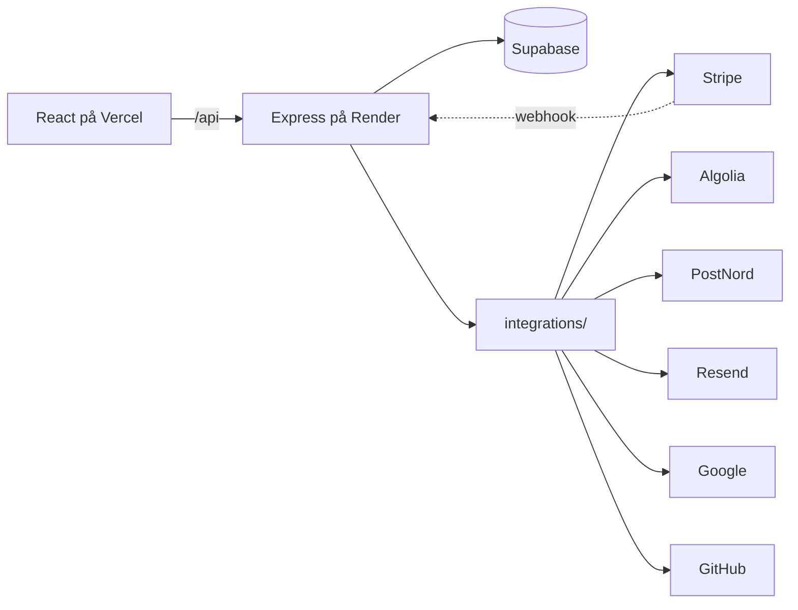

# ReLoved

ReLoved är en webbshop för second hand kläder där privatpersoner säljer till varandra. Varje annons granskas innan den publiceras, och köparen betalar med kort.

Butiken finns på [re-loved.se](https://re-loved.se). Betalningen körs i Stripes testläge, så inga riktiga pengar dras. Testa med kortnumret `4242 4242 4242 4242`, ett datum i framtiden och valfri CVC.

---

## Funktioner

**Köpare** söker bland plaggen med stavfeltolerans, filtrerar på kategori, skick och pris. Sparar favoriter och ser priser i SEK, EUR, USD eller GBP. I kassan väljer kunden ett PostNord-ombud nära sitt postnummer eller hemleverans, betalar via Stripe och får en orderbekräftelse via e-post. Inloggade kunder ser sina ordrar under Mina ordrar.
Glömmer kunden sitt lösenord kan hon få en engångslänk via e-post och välja ett nytt.

**Säljare** lägger upp annonser med bild, redigerar dem och följer sina försäljningar.

**Administratörer** godkänner eller nekar annonser, hanterar produkter, kategorier och orderstatus, importerar leverantörens katalog och rapporterar fel direkt till projektets ärenden på GitHub.

## Tech stack

| Del                | Teknik                                          |
| ------------------ | ----------------------------------------------- |
| Frontend           | React 19, TypeScript, Vite, React Router        |
| Backend            | Node.js 22, Express 5, Zod                      |
| Databas och bilder | PostgreSQL och Storage i Supabase               |
| Drift              | Vercel (frontend), Render (API), Loopia (domän) |

## Arkitektur



React pratar bara med det egna API:et. Vercel skickar alla anrop till `/api` vidare till Render, så att frontend och API nås på samma adress.

Varje extern tjänst har en egen adapter i `server/integrations/`. Adaptern är det enda stället som känner till tjänstens adress, nycklar och svarsformat. Den har en timeout, validerar svaren med Zod och returnerar shoppens egen modell. Byts en tjänst ut påverkas bara en fil.

| Tjänst            | Används till                                    | Adapter                |
| ----------------- | ----------------------------------------------- | ---------------------- |
| Stripe            | Betalning via Checkout och webhook              | `paymentAdapter.ts`    |
| Algolia           | Sökning, filter och sortering                   | `searchAdapter.ts`     |
| Supabase Storage  | Produktbilder                                   | `storageAdapter.ts`    |
| PostNord          | Ombud och leveranstid                           | `shippingAdapter.ts`   |
| Frankfurter       | Valutakurser                                    | `currencyAdapter.ts`   |
| Leverantörens API | Produktkatalog i CSV, XML och JSON              | `supplierAdapter.ts`   |
| Google            | Inloggning för kunder                           | `googleAuthAdapter.ts` |
| GitHub            | Inloggning för administratörer och felrapporter | `githubAdapter.ts`     |
| Resend            | Orderbekräftelser via e-post                    | `emailAdapter.ts`      |

Hur varje integration fungerar och vad som händer när den inte svarar beskrivs i [docs/06-integrationer.md](docs/06-integrationer.md).

## Inloggning och autentisering

Kunder loggar in med e-post och lösenord eller med Google. Administratörer loggar in med GitHub. All inloggning går via servern. Client secrets och andra nycklar finns bara i serverns miljövariabler, och inga tokens från Google eller GitHub når webbläsaren.

### Inloggningsflödet

Google och GitHub använder båda OAuth 2.0 med authorization code flow. Google lägger dessutom till OpenID Connect, som ger ett ID-token med vem användaren är.

1. Användaren klickar på "Fortsätt med Google" eller "Logga in som administratör". Det är en vanlig länk till `/api/auth/google` eller `/api/auth/github` på servern.
2. Servern skapar slumpvärden för `state` och en PKCE code verifier, och för Google även en `nonce`. Värdena sparas i en signerad, httpOnly-cookie som gäller i tio minuter. Servern skickar sedan användaren vidare till Google eller GitHub med `state`, en code challenge (SHA-256 av verifiern) och de scopes som behövs: `openid email profile` för Google och `read:user` för GitHub.
3. Användaren loggar in hos Google eller GitHub och godkänner. Lösenordet anges bara där, aldrig hos ReLoved.
4. Google eller GitHub skickar tillbaka användaren till `/api/auth/.../callback` med en engångskod och samma `state`.
5. Servern kontrollerar att `state` är exakt det värde som sparades i cookien. Annars avbryts inloggningen.
6. Servern byter koden mot tokens med client secret och code verifier, direkt mellan servrarna.
7. **Google:** servern läser ID-tokenet och validerar det med Zod: utfärdare (`iss`), mottagare (`aud`), giltighetstid (`exp`), `nonce` och verifierad e-post. Kunden känns igen på `sub`.
   **GitHub:** servern hämtar användaren från `GET /user` och validerar svaret med Zod. Bara användarnamn i `ADMIN_GITHUB_LOGINS` blir administratörer, och de sparas med GitHubs `id`.
8. Servern sätter shoppens egen inloggningscookie och skickar användaren vidare. Google eller GitHub är inte inblandade efter det.

Om användaren avbryter, om `state` inte stämmer eller om tjänsten inte svarar inom tidsgränsen, skickas användaren tillbaka med en felkod. Sidan visar då ett begripligt meddelande.

**Vad state och PKCE skyddar mot.** Jag använder båda.
- `state` skyddar mot CSRF i inloggningen. Utan det skulle en angripare kunna skicka offret en callback-länk med angriparens egen kod och logga in offret på angriparens konto. Allt offret sedan gör, till exempel att spara en adress, skulle hamna där.
- PKCE skyddar själva koden. Om någon snappar upp koden på vägen tillbaka, till exempel via en webbläsartillägg eller en logg, går den inte att byta mot tokens utan code verifiern, som bara finns i serverns cookie.
- `nonce` (bara Google) knyter ID-tokenet till just den här inloggningen, så att ett gammalt ID-token inte kan återanvändas.

### Tokens

| Token | Från | Används till | Var den sparas | Livslängd |
|---|---|---|---|---|
| Authorization code | Google, GitHub | Byts mot tokens i steg 6 | Ingenstans, bara i adressen till callbacken | Några minuter, en gång |
| Google ID-token | Google | Läsa kundens `sub`, e-post och namn | Ingenstans, används och slängs | 1 timme |
| Google access token | Google | Används inte | Ingenstans | 1 timme |
| GitHub access token | GitHub | Ett anrop till `GET /user` | Ingenstans, används och slängs | Tills den återkallas |
| Inloggningsförsöket (state, verifier, nonce) | Servern | Kontrollera callbacken | Signerad httpOnly-cookie | 10 minuter, tas bort efter callback |
| Shoppens session-JWT | Servern | Visa vem som är inloggad | httpOnly-, secure-, SameSite=Lax-cookie | 7 dagar |
| Shoppens GitHub-token | Mig, fine-grained | Skapa och läsa issues | Serverns miljövariabler | Utgångsdatum satt vid skapandet |
| Resends API-nyckel | Mig | Skicka mejl | Serverns miljövariabler | Tills den återkallas |

Ingen refresh token begärs, eftersom shoppen inte behöver anropa Google eller GitHub för användarens räkning efter inloggningen. Tokens som inte sparas kan inte heller läcka.

### Session med JWT i en httpOnly-cookie

Efter inloggningen sätter servern en JWT med användarens id, roll och e-post i cookien `reloved_session`, signerad med `JWT_SECRET`. Varje anrop till API:et skickar cookien automatiskt, och servern kontrollerar signaturen.

Jag valde JWT framför en session i databasen eftersom servern då inte behöver slå upp något för att veta vem som är inloggad, och Render kan starta om utan att någon loggas ut. Cookien är `httpOnly`, så JavaScript kan inte läsa den, och en XSS-attack kan inte stjäla den. Tidigare låg token i localStorage, där all kod på sidan kunde läsa den. Eftersom Vercel skickar `/api` vidare till Render ligger sajten och API:et på samma adress, så cookien är en förstapartscookie som webbläsaren inte blockerar.

### Risker och hur en token spärras

**Om shoppens JWT stjäls** kan den användas för att vara inloggad som den personen tills den går ut efter sju dagar. Utloggning tar bara bort cookien från den egna webbläsaren, inte kopian. Det här är JWT:ns största nackdel: den går inte att spärra en och en. Det enda sättet att spärra alla är att byta `JWT_SECRET`, och då loggas alla ut. Risken minskas av att cookien är `httpOnly`, `secure` och `SameSite=Lax`, vilket gör den svår att komma åt från början.

**Om adminens GitHub-token stjäls** under inloggningen ger den bara läsrätt till profilen, eftersom scopet är `read:user`. Shoppen sparar den inte. Den slutar gälla när admin återkallar ReLoved under GitHub → Settings → Applications.

**Om shoppens GitHub-token läcker** kan den bara skapa och läsa issues i ett enda repo, eftersom den är fine-grained och har ett utgångsdatum. Den spärras direkt under GitHub → Settings → Developer settings → Personal access tokens, och en ny läggs in på Render.

**Om en client secret eller Resends nyckel läcker** genereras en ny i Google Cloud Console, GitHub eller Resend, och den gamla tas bort. Därför har produktionen egna OAuth-appar, så att produktionens secrets aldrig finns på min dator.

**Lösenordsåterställning** använder en egen sorts token: en slumpad engångskod i en länk via e-post. Bara en hash av koden sparas, den gäller i 30 minuter och kan bara användas en gång.

### När session respektive JWT passar bäst

En session i databasen passar när man måste kunna spärra en inloggning direkt, till exempel för administratörer, vid misstänkt intrång eller när ett lösenord byts. Servern behöver bara ta bort raden. Priset är en databasfråga för varje anrop.

JWT passar när många servrar eller tjänster ska kunna kontrollera inloggningen utan att dela databas, och när det är acceptabelt att en inloggning gäller tills den går ut.

För ReLoveds kunder räcker JWT gott. För administratörerna hade en session, eller en mycket kortare JWT, varit säkrare, eftersom ett stulet admin-konto kan göra mer skada. En förbättring jag skulle göra i en riktig butik är att spara när lösenordet senast byttes och avvisa JWT:er som är äldre än det. Då loggas alla gamla inloggningar ut när någon återställer sitt lösenord.

### Konton

Kunden känns igen på Googles `sub`, som aldrig ändras. Första gången skapas en kund med `sub`, e-post och namn, och nästa gång hittas samma kund via `sub`. Lösenordsinloggningen finns kvar som ett andra sätt att logga in.

Finns e-postadressen redan hos ett konto med lösenord slås kontona inte ihop. Kunden får i stället ett meddelande om att logga in med sitt lösenord. En automatisk sammanslagning skulle ge den som kontrollerar ett Google-konto med samma adress tillgång till någon annans ordrar och adress.

Administratörer sparas med GitHubs `id`, eftersom användarnamnet kan ändras. En regel i databasen gör att bara konton med ett GitHub-id kan ha rollen admin. E-postadresser sparas med små bokstäver, och databasen tillåter inte samma adress två gånger.

## Betalning och orderbekräftelse

Kassan sparar en obetald order och skickar kunden till Stripe Checkout. Ordern blir betald först när Stripes signerade webhook kommer fram. Databasfunktionen `mark_order_paid` gör det exakt en gång och minskar lagret i samma transaktion. Kommer kunden tillbaka innan webhooken har kommit frågar servern Stripe direkt.

När ordern är betald skickar servern en orderbekräftelse med Resend från `order@re-loved.se`. Mejlet innehåller ordernummer, kundens namn, produkterna med antal och pris samt totalsumman, både som HTML och som text. Allt som kunder och säljare har skrivit escapas innan det hamnar i HTML:en.

- Varje utskick har nyckeln `order-confirmation/{orderns id}`. Om Stripe skickar webhooken igen får kunden ändå bara ett mejl.
- Mejlet skickas efter att Stripe har fått sitt svar. Svarar Resend inte, eller svarar med ett fel, loggas felet. Ordern är ändå betald.
- Mallarna ligger i `server/emails/`. Utseendet är samlat i `styles.js` och sätts in inline när mejlet byggs, eftersom e-postprogram inte läser CSS-filer.

Domänen är verifierad i Resend med DKIM, SPF och DMARC.

## Felrapporter

Administratörer kan rapportera fel från administratörspanelen. Servern skapar ett ärende i repot med en egen fine-grained token som bara har behörigheten Issues: Read and write för det här repot. GitHub visar tokenens ägare som författare, så servern skriver in vilken administratör som rapporterade felet. Panelen listar också öppna ärenden med länkar till GitHub.

## Sökindex

Produkterna söks i Algolia, som håller en kopia av databasen. Indexet uppdateras när en produkt sparas, säljs eller tas bort. Varje natt bygger ett GitHub Actions-jobb om hela indexet via `POST /api/cron/reindex`, som skyddas av `CRON_SECRET`. Omindexeringen tar några minuter, så servern svarar direkt och bygger klart i bakgrunden.

## Kom igång

Projektet består av API:et i `server/` och frontend i `reloved-app/`. Du behöver Node.js 22.6 eller senare, eftersom servern kör TypeScript-adaptrarna direkt.

### Databas

Skapa ett projekt i Supabase och kör filerna i SQL Editor i den här ordningen:

1. `database/schema.sql`
2. `database/migrations/payments.sql`
3. `database/migrations/shipping.sql`
4. `database/migrations/sizes.sql`
5. `database/migrations/google_login.sql`
6. `database/migrations/github_admin.sql`
7. `database/migrations/password_resets.sql`

Skapa sedan en publik Storage-bucket som heter `products`.

### Server

```bash
cd server
npm install
cp .env.example .env
npm run dev
```

API:et körs på `http://localhost:3001`. Alla variabler finns i [`server/.env.example`](server/.env.example).

| Variabler                                                                                                    | Används till                                          |
| ------------------------------------------------------------------------------------------------------------ | ----------------------------------------------------- |
| `SUPABASE_URL`, `SUPABASE_SERVICE_KEY`                                                                       | Databas och bilder                                    |
| `JWT_SECRET`, `NODE_ENV`                                                                                     | Inloggningscookien. `production` gör cookien `secure` |
| `GOOGLE_CLIENT_ID`, `GOOGLE_CLIENT_SECRET`, `GOOGLE_REDIRECT_URI`                                            | Inloggning med Google                                 |
| `GITHUB_CLIENT_ID`, `GITHUB_CLIENT_SECRET`, `GITHUB_REDIRECT_URI`, `ADMIN_GITHUB_LOGINS`                     | Inloggning för administratörer                        |
| `GITHUB_ISSUES_TOKEN`, `GITHUB_REPO`                                                                         | Felrapporter                                          |
| `STRIPE_SECRET_KEY`, `STRIPE_WEBHOOK_SECRET`, `CLIENT_URL`, `CHECKOUT_EXPIRES_MINUTES`                       | Betalning                                             |
| `RESEND_API_KEY`, `EMAIL_FROM`                                                                               | Orderbekräftelser                                     |
| `ALGOLIA_APP_ID`, `ALGOLIA_ADMIN_KEY`, `ALGOLIA_SEARCH_KEY`, `ALGOLIA_INDEX`                                 | Sökning                                               |
| `POSTNORD_API_KEY`, `POSTNORD_API_URL`, `SHOP_POSTAL_CODE`, `SHOP_STREET`, `SHOP_CITY`, `FREE_SHIPPING_FROM` | Frakt                                                 |
| `CURRENCY_API_URL`, `SUPPLIER_API_URL`, `SUPPLIER_API_KEY`                                                   | Valutakurser och leverantör                           |
| `CRON_SECRET`                                                                                                | Nattlig omindexering                                  |

Variabler som slutar på `_TIMEOUT_MS` har rimliga standardvärden och behöver inte sättas.

För att testa betalningar lokalt behövs [Stripe CLI](https://docs.stripe.com/stripe-cli). Kör det här i en egen terminal och lägg in `whsec_…` som den skriver ut som `STRIPE_WEBHOOK_SECRET`:

```bash
stripe listen --events checkout.session.completed,checkout.session.async_payment_succeeded,checkout.session.expired --forward-to localhost:3001/api/stripe/webhook
```

Lokalt kan Resend bara skicka till e-postadressen på ditt eget Resend-konto, om du inte har verifierat en egen domän.

### Frontend

```bash
cd reloved-app
npm install
npm run dev
```

Appen körs på `http://localhost:5173`. Vite skickar `/api` vidare till servern, så ingen `.env` behövs.

## Deploy

- **Vercel** bygger `reloved-app/`. `vercel.json` skickar `/api` vidare till Render, skickar `re-loved.vercel.app` vidare till `re-loved.se` och sätter säkerhetsheaders. `VITE_API_URL` ska inte sättas.
- **Render** kör `server/` med samma variabler som i `.env`, med `NODE_ENV=production` och adresser som pekar på `https://re-loved.se`.
- **Stripe** har en webhook till `https://reloved.onrender.com/api/stripe/webhook`.
- **Google och GitHub** har callback-adresserna `https://re-loved.se/api/auth/google/callback` och `https://re-loved.se/api/auth/github/callback`.
- **GitHub Actions** behöver `CRON_SECRET` under Settings → Secrets.
- **Loopia** pekar `re-loved.se` och `www` på Vercel och har Resends DNS-poster.

## Projektstruktur

```
├── database/          Schema och migrationer
├── docs/              Sitemap, användarflöde, databas, API-plan, integrationer och reflektion
├── server/
│   ├── emails/        Mejlmallar och deras utseende
│   ├── integrations/  En adapter per extern tjänst
│   ├── lib/           Cookies, databas, felhantering, uppladdning och bilder
│   ├── middleware/    Inloggning och roller
│   ├── routes/        API:ets routes
│   ├── scripts/       Engångsskript, t.ex. optimering av befintliga bilder
│   └── services/      Affärslogik: kassa, betalning, produkter och sökindex
└── reloved-app/
    ├── public/        Stilar, bilder och robots.txt
    └── src/
        ├── api/       Anrop till API:et
        ├── components/
        ├── context/   Inloggning, varukorg, favoriter, valuta och notiser
        ├── hooks/
        ├── pages/     Sidor, inklusive admin/ och seller/
        ├── types/
        └── utils/
```

## Dokumentation

- [Integrationer](docs/06-integrationer.md)
- [Reflektion](docs/07-reflektion.md)
- [Databasdesign](docs/03-database-design.md), [API-plan](docs/05-api-plan.md), [Sitemap](docs/01-sitemap.md) och [Användarflöde](docs/02-user-flow.md)

## Licens

Utbildningsprojekt — ej för kommersiellt bruk.
